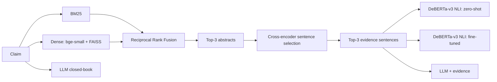
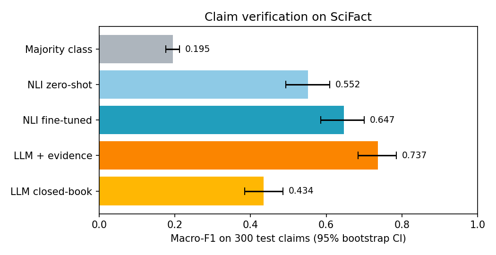
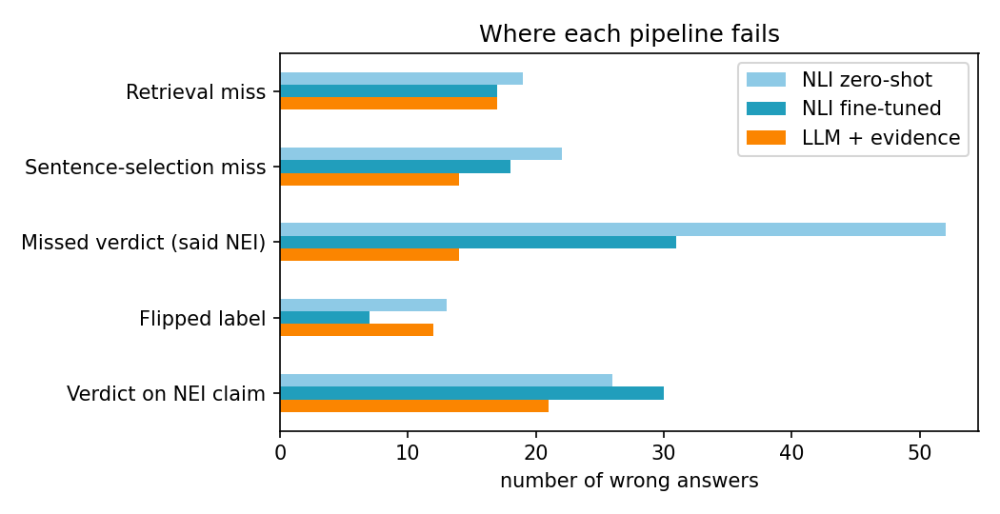

# Evidence-Grounded Claim Verification: Retrieval + NLI vs. LLM

A retrieve-then-verify fact-checking pipeline benchmarked on [SciFact](https://github.com/allenai/scifact): 5,183 research abstracts and expert-written scientific claims labelled SUPPORT, CONTRADICT, or NOT ENOUGH INFO. It compares retrievers, then compares a zero-shot NLI model, a fine-tuned NLI model and an LLM on identical evidence, and measures how often each one gives a verdict it can't back up.

## Results

Scored on 300 held-out claims (SciFact dev set; official test labels are hidden). Thresholds and the retriever were chosen on a separate 100-claim validation split.

| System | Macro-F1 | 95% CI | Accuracy | Strict acc. | Ungrounded verdicts | Latency (ms/claim) |
|---|---|---|---|---|---|---|
| Majority class | 0.195 | 0.176–0.212 | 41.3% | n/a | n/a | n/a |
| NLI zero-shot | 0.552 | 0.493–0.609 | 56.0% | 48.0% | 51.2% | 9 |
| NLI fine-tuned | 0.647 | 0.585–0.700 | 65.7% | 57.3% | 38.2% | 29 |
| LLM + evidence | 0.737 | 0.684–0.785 | 74.0% | 66.3% | 28.0% | 1123 |
| LLM closed-book | 0.434 | 0.384–0.485 | 48.3% | n/a | n/a | 1165 |

## Failure analysis

I read about 20 wrong predictions from the LLM + evidence system and about 16 from the fine-tuned NLI system. They fall into four patterns (counts are LLM / fine-tuned NLI, from `results/failures.csv`).

| Pattern | What happens | Count |
|---|---|---|
| Committing on an NEI claim | Evidence is on-topic but doesn't settle the claim; the model picks a side anyway | 21 / 30 |
| Abstaining when inference is needed | Evidence is relevant but no single sentence states the claim (e.g. a specific mechanism), so the model says NEI | 14 / 31 |
| Reading direction wrong | Support and contradict are swapped on claims with negation, numbers or comparisons | 12 / 7 |
| Wrong evidence reached the verifier | The right paper or sentence was not retrieved, so NEI is a sensible answer | 31 / 35 |

**Takeaway:** Most errors are not retrieval errors. 60% of the LLM's mistakes and 66% of the fine-tuned NLI's happen at the verdict stage, and almost all of those are about deciding whether the evidence is *enough* (NEI vs. a verdict), not support vs. contradict. The fine-tuned NLI under-commits (31 missed verdicts), while both verifiers sometimes commit on claims the retrieved evidence does not settle. A few NEI cases (e.g. the statin claims) are arguably label ambiguity, so the NEI boundary is partly a limit of the dataset as well as of the models.

Limitation: I read the first rows of each category, not a random sample, so the examples illustrate the patterns and the counts come from the full failure table.

**Key findings**

- **Best system:** LLM + evidence, macro-F1 0.737 (95% CI 0.684–0.785).
- **Fine-tuning on SciFact** moved the NLI verifier from 0.552 to 0.647 macro-F1 (seed 42; mean 0.666 ± 0.015 over 3 seeds).
- **Retrieval for the LLM:** closed-book 0.434 vs. with evidence 0.737 macro-F1.
- **Grounding:** ungrounded verdicts were 38.2% for the fine-tuned NLI model and 28.0% for the LLM with evidence.
- **Most common failure** for LLM + evidence: verdict on nei claim (21 of 78 errors).
- **Retrieval:** Dense (bge-small + FAISS) was chosen on validation (Recall@3 0.911). On test, at least one gold abstract is in the top 3 for 87.2% of claims with evidence; the table below reports Recall@k, the average fraction of a claim's gold abstracts retrieved.

### Retrieval (validation and test)

| Split | Retriever | Recall@1 | Recall@3 | Recall@5 | Recall@10 |
|---|---|---|---|---|---|
| val | BM25 | 0.565 | 0.722 | 0.843 | 0.879 |
| val | Dense (bge-small + FAISS) | 0.810 | 0.911 | 0.931 | 0.984 |
| val | Hybrid (RRF) | 0.661 | 0.859 | 0.899 | 0.952 |
| test | BM25 | 0.712 | 0.832 | 0.865 | 0.936 |
| test | Dense (bge-small + FAISS) | 0.744 | 0.859 | 0.898 | 0.957 |
| test | Hybrid (RRF) | 0.741 | 0.867 | 0.917 | 0.953 |

Dense retrieval was selected on the validation split (best Recall@3). On test, hybrid (RRF) is slightly
higher at Recall@3 and Recall@5, but the gaps are within about two points, so I kept the validation-chosen
retriever rather than re-selecting on test.

### Where the pipelines fail

| Error type | NLI zero-shot | NLI fine-tuned | LLM + evidence |
|---|---|---|---|
| Retrieval miss | 19 | 17 | 17 |
| Sentence-selection miss | 22 | 18 | 14 |
| Missed verdict (said NEI) | 52 | 31 | 14 |
| Flipped label | 13 | 7 | 12 |
| Verdict on NEI claim | 26 | 30 | 21 |

## Method

| Stage | Choice |
|---|---|
| Retrieval | BM25 (`rank_bm25`), dense `BAAI/bge-small-en-v1.5` + FAISS, hybrid via Reciprocal Rank Fusion |
| Sentence selection | `cross-encoder/ms-marco-MiniLM-L-6-v2`, top 3 sentences from top 3 abstracts |
| NLI verifier | `MoritzLaurer/DeBERTa-v3-base-mnli-fever-anli`; max entailment/contradiction over sentences, NEI below a validation-tuned threshold |
| Fine-tuning | Gold rationales + retrieved hard negatives, 2 epochs, lr 2e-05, 3 seed(s) |
| LLM verifier | `qwen/qwen3.8-27b` via an OpenAI-compatible API, temperature 0 |

**Metrics.** Macro-F1 with 1,000-sample bootstrap CIs; *strict accuracy* requires the cited sentence to be a gold rationale; *ungrounded verdicts* is the share of SUPPORT/CONTRADICT answers whose cited evidence is not a gold rationale.

## Run it

Open `claim_verification.ipynb` in Google Colab with a T4 GPU, add `LLM_API_KEY` to Colab Secrets, and Run all. The last section launches a Gradio demo where you can type any claim.

## Limitations

- 300 test claims is small, which is why the confidence intervals are reported.
- One LLM was tested; results may differ for other models and prompts.
- Latency covers only the verifier step, not the shared retrieval.

## Data and citation

SciFact is released under CC BY-NC 2.0. Wadden et al., *Fact or Fiction: Verifying Scientific Claims*, EMNLP 2020.
